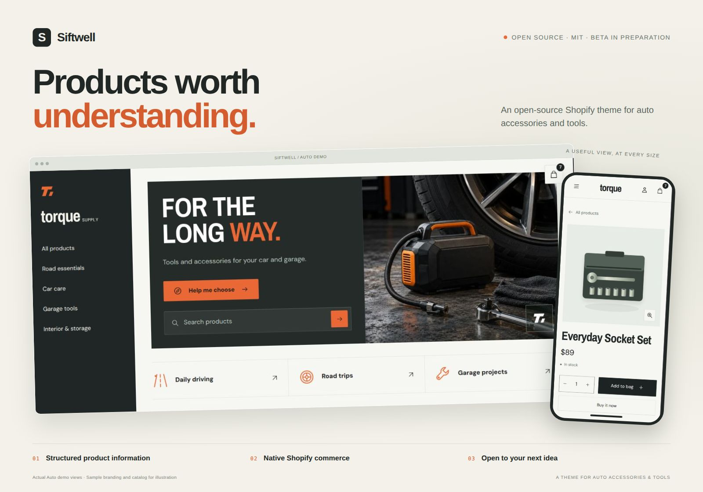
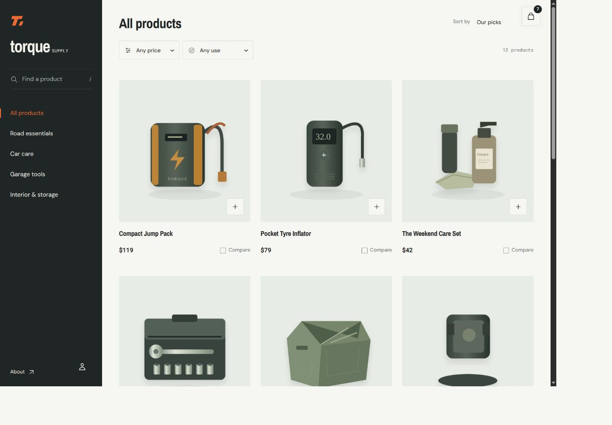
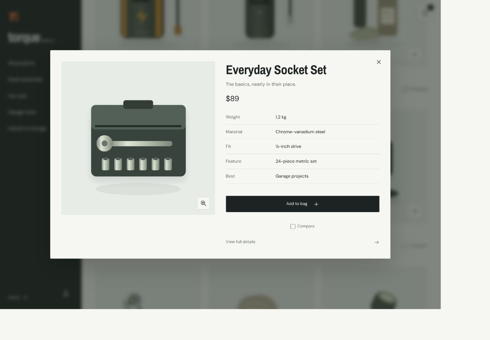
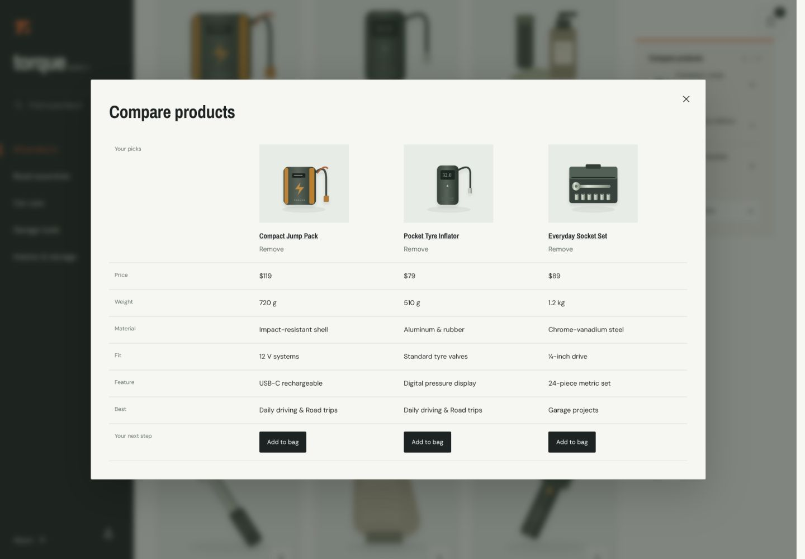

# Siftwell



**[Download theme ZIP ↓](https://raw.githubusercontent.com/lixonic/Siftwell-Shopify-theme/main/docs/downloads/Siftwell-0.8.0-beta.1.zip)** · [Installation guide](https://siftwell-theme-docs.vercel.app/?page=installation)

**An open-source Shopify theme for products worth understanding.**

Siftwell is built for auto accessories and tools, where fit, materials and intended use help someone choose. Customers can find products by name or buying need, inspect details in quick view and compare their options. A steady sidebar and open product areas keep the catalog close and the products in view.

[Open the live demo](https://siftwell-theme.myshopify.com/) · [Documentation](https://siftwell-theme-docs.vercel.app/) · [Try the source](#development)

**Demo visitor password:** `siftwell`

## Built around the buying decision

- **Find a useful starting point.** Search by product name, browse recognizable collections or begin with a need such as Road trips or Garage projects. The finder opens the collections you choose.
- **Start shopping sooner on a phone.** The compact mobile introduction puts a short shopping heading and search first, followed by a secondary help link and compact collection routes. Desktop keeps the workshop hero.
- **Keep the facts consistent.** Use editable specification rows for each product family and override facts for the selected variant. Product pages, quick view and comparison share the renderer; existing Weight, Material, Fit, Feature and Best mappings keep working.
- **Check the setup requirements.** Show selected-variant requirements, exclusions and a reference beside buying controls. Empty or inaccessible profiles show an honest unknown state; the theme does not verify vehicle fit. [Set up compatibility guidance](docs/product-compatibility.md).
- **Know what is supplied separately.** Show box contents, required extras and optional additions from one reusable saved set. Differing variants replace the complete set; unconfigured products stay hidden. Optional native product links open the item for review without implying verified compatibility. [Set up included parts and extras](docs/product-parts.md).
- **Compare without losing your place.** Inspect an item in quick view or put up to three products side by side. Comparison appears when customers select products and can be disabled for catalogs that do not need it.
- **Give recommendations a purpose.** Related and complementary cards hide comparison by default. Enable it separately for curated related alternatives; accessories stay focused on viewing and adding.
- **Give practical products room.** A workshop-style sidebar, direct headings, restrained color and brief motion provide a steady frame for your products, photographs and words.
- **Include customer experience.** Show rating summaries supplied through Shopify’s standard review fields, and place a review app’s full widget in the Customer reviews section. Review collection and moderation belong to the provider; [a real provider integration remains unverified](docs/product-reviews.md).

The finder and specification fields present the information you configure. They do not calculate or verify vehicle compatibility.

## Performance and accessibility

Siftwell keeps the storefront in server-rendered Liquid, with deferred JavaScript and no frontend runtime framework. Responsive images, priority loading for the initial product image and media that loads on request help keep the work focused on what a customer is viewing.

Keyboard navigation is part of the shopping experience: a skip link, visible focus, Escape-to-close dialogs, focus return and focus retention after sorting or filtering. The source also includes reduced-motion styles, semantic headings and native product/cart forms.

**Recorded demo results — 20 October 2026, Auto 0.7.4:**

| Lighthouse performance / 100 | Mobile | Desktop |
| --- | ---: | ---: |
| Home | 60 | 85 |
| Collection | 65 | 77 |
| Product | 63 | 86* |

These are medians of warning-free runs on the populated demo. Each cell has three samples except desktop product (*two; provisional). **Automated accessibility scored 100/100 in all 21 recorded runs**, including four with incomplete-load warnings. Sampled default-palette contrast was **14.86:1 for body text** and **5.33:1 for accent-button text**.

The results describe the earlier demo checkpoint; the downloadable 0.8.0 source has not had a fresh Lighthouse audit. Scores vary with content, apps and hosting conditions. Screen-reader speech, Safari, Firefox and physical-device verification remain open. Read the [results, methods and coverage](https://siftwell-theme-docs.vercel.app/?page=performance-accessibility) before using these numbers to assess your store.

## See the theme

| Browse the catalog | Inspect the useful details |
| --- | --- |
|  |  |

**Put the details side by side.** The comparison view uses the same product specifications as quick view and the product page.



Screenshots show the Auto demo with sample branding and content. Add your own catalog, licensed media and accurate fit information; the demo content is not included in the installable theme. [Image notes](docs/images/README.md).

## Make the source your own

Use Shopify's theme editor to arrange sections and product blocks, choose fonts and colors, and add your branding. App blocks and Custom Liquid provide places for store-specific extensions.

The theme source is MIT-licensed. Developers can inspect it, adapt it and share improvements while keeping the license notice. Shopify's hosted platform and any separate app services have their own terms.

For developers working with coding agents, [AGENTS.md](AGENTS.md) explains the architecture and conventions, while [DESIGN.md](DESIGN.md) records the design intent. Those files give an agent context for extending the theme consistently. [Contributions](CONTRIBUTING.md) are welcome.

## When shopping starts with an assistant

A customer may arrive with a recommendation already in mind. Siftwell helps them inspect it through clear product facts, visible options and useful comparisons. Its pages use server-rendered Liquid, semantic HTML and Shopify-generated product JSON-LD.

That is the theme's role in assisted shopping. [Shopify provides agent discovery and transaction services](https://shopify.dev/docs/agents); availability depends on the store and service setup. Installing Siftwell does not activate an AI sales channel or guarantee recommendations. Custom specification fields are not automatically included in every agent's catalog.

## Start with your catalog

- [Start with Siftwell](https://siftwell-theme-docs.vercel.app/): the shopping experience and the design behind it.
- [Build your first shopping path](https://siftwell-theme-docs.vercel.app/?page=getting-started): connect a buying need to a collection, product and bag.
- [Set up product specifications](https://siftwell-theme-docs.vercel.app/?page=specifications): keep useful details consistent across product views.
- [Set up product facts with Sidekick](docs/product-data-sidekick.md): prepare supplier facts, review reusable entries and select their product/variant references in Shopify.
- [Edit catalog facts in a spreadsheet](docs/catalog-data.md): download the blank XLSX and worked inflator example. This optional prototype organizes existing native facts and needs developer assistance for imports.
- [Get community help](SUPPORT.md): setup questions, reproducible issues and contributions.
- [Follow the roadmap](ROADMAP.md): auto-parts buying decisions, verified fit information and accurate data for AI-assisted shopping.

Read the complete [searchable merchant guide online](https://siftwell-theme-docs.vercel.app/). Its source is included in `docs/`. To preview it locally:

```sh
python3 -m http.server 8774 --bind 127.0.0.1 --directory docs
```

Open `http://127.0.0.1:8774` to browse the complete guide.

## Before using the beta

Version **0.8.0-beta.1** is in preparation, with no tagged release yet. Fresh-install and essential shopping-path checks remain before a packaged beta release. Review the [known limitations](docs/known-limitations.md) and test your catalog, apps and store configuration before planning a launch.

Siftwell includes native Shopify product forms, a cart drawer and cart page, product galleries and zoom, localization settings and editable sections. Shopify supplies accounts, checkout and the hosted commerce platform. Source checks do not establish compatibility with every store or device.

## Development

Use a current Shopify CLI, Node.js 22 or later and Python 3:

```sh
npm ci
npm test
shopify theme check --path .
shopify theme dev --path . --store YOUR-STORE.myshopify.com
```

Before building a theme ZIP, run `npm run validate` and `shopify theme package --path .`. To refresh the downloadable theme ZIP, run `npm run package:download`; validation checks that its contents match the theme source. Keep the included MIT notice in every distribution. A GitHub source archive contains project files and is different from a packaged Shopify theme ZIP.

Read [Contributing](CONTRIBUTING.md) before opening a pull request. Never commit a store password, Theme Access token, live merchant settings or customer data.

## License

[MIT](LICENSE). See [Provenance](PROVENANCE.md) and [Notices](NOTICES.md) for the source history and external-service boundaries. Shopify and third-party brand names remain their owners' trademarks.
